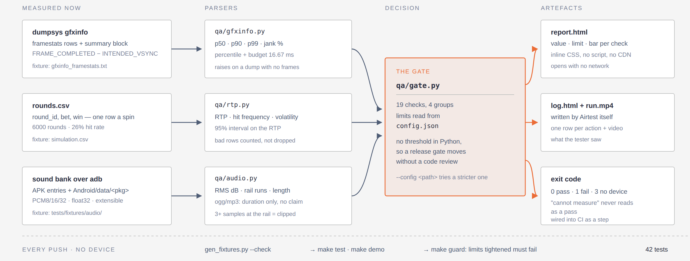

# gameqa-lab


Three checks a slot build has to survive before someone calls it releasable, written
so that the numbers are reproducible and the gate can actually close.

| what | why it is not a screenshot test | runs in CI |
|---|---|---|
| frame time | per-frame duration from `dumpsys gfxinfo … framestats`, not a histogram guess | yes (recorded fixtures) |
| slot maths | RTP, hit frequency, volatility and a 95% interval from one row per round | yes (designed fixture) |
| audio bank | WAV decoded with the standard library (PCM8/16/32, float32, extensible): silence, clipping, length | yes (generated clips) |
| device flow | Airtest taps, `device().shell()` measures, both in the same run | no — needs a device |



**Example of a real run, not a fixture:** [`docs/evidence/emulator-2026-11-16/`](docs/evidence/emulator-2026-11-16/)
holds one Android run end to end — the device's frame rows, 12 WAV files pulled over adb,
the Airtest log, the recording, and [`report.html`](docs/evidence/emulator-2026-11-16/report.html)
rendered from those files. The gate failed there, and the folder's README says why.

## Verify in 60 seconds

```bash
git clone https://github.com/lasttoss/gameqa-lab && cd gameqa-lab
make test            # 42 tests, no device, no network, no API keys
make demo            # 16 checks against the recorded fixtures → gate=armed failed=0
make guard           # tightens two limits and asserts the gate turns red
make fixtures-check  # the fixtures are what the generator produces
```

Then open `docs/evidence/emulator-2026-11-16/report.html` in a browser — a real device
run, one self-contained file, gate failed (89.2% of frames over budget on a software GPU).

`make demo` prints one block and exits 0. `make guard` prints
`RESULT guard=armed baseline=PASS tightened=FAIL failed_checks=...` and exits 0 only
when the tightened limits really do fail — a check that cannot fail is decoration.
If a number in this README stops matching the output, that is a bug in the README,
not in the code.

## What is measured, and what is not

The three fixture files under `tests/fixtures/` are **generated**, not captured from
a phone: `tools/gen_fixtures.py` builds them from a fixed seed. So:

* the RTP figure (0.9537) is a **design decision** baked into
  `HIT_DISTRIBUTION`, and the parser is proven to recover it — that is a parser
  test, not a statement about any real game;
* the frame times are **synthetic** (240 frames, ~9 ms typical, a long frame every
  37th frame), which proves the percentile and jank arithmetic, not the smoothness
  of a build;
* the audio clips are three generated sine tones, so the gate proves the decoder and
  the thresholds work — it says nothing about how a build sounds. For `.ogg` and `.mp3`
  the duration comes from the container (Vorbis granule position, MP3 bitrate estimate)
  and that is all: no waveform, no claim about loudness or clipping;
* **the frame source is Android's View renderer, not a game engine.** `dumpsys gfxinfo … framestats`
  records what the hardware-accelerated View pipeline draws. A Unity, libGDX or other GL title — which
  is what most slot builds are — draws into a GL surface and reports almost nothing here: measured on
  this machine, `org.andstatus.game2048` returned **2** frames and `com.agateau.burgerparty` returned
  **10**, on screens that were visibly animating. For those titles the frame source has to be
  `dumpsys SurfaceFlinger --latency <layer>`, which this repo does **not** implement yet. A passing
  frame gate here therefore says nothing about a Unity build.
* nothing here has been run against a production slot game. `flows/slot_smoke.py` returns exit **3** when no device is attached,
  because "no device" must never look like "passed".

## The artefacts a reviewer actually opens

Airtest writes the run log; this repo does not re-implement it.

```bash
./scripts/run_flow.sh com.example.slot        # run + recording + report
```

| file | who writes it | what is in it |
|---|---|---|
| `out/airtest-report/log.html` | `airtest report` | one row per action, the screenshot after it, and the gate result |
| `out/airtest-report/*.mp4` | `airtest run --recording` | the same run, recorded |
| `out/airtest-report/` (whole dir) | `--export` | self-contained: images and video travel with the html |

`airtest run` only writes `log.txt` + screenshots; `log.html` comes from a second
command, `airtest report --log_root <dir> --outfile log.html --export <dir>`. Both
lines are in `scripts/run_flow.sh`, verified against airtest 1.4.3 source.

Separately, `python -m qa html out/report.html` renders the **gate** as one file —
value, limit, and a bar per check. That one answers "does this build pass", the
Airtest log answers "what did the tester see". Two questions, two files.

An APK to dry-run the whole thing without a client build is in
[docs/EXAMPLE-APK.md](docs/EXAMPLE-APK.md): a plain metronome app, 3.1 MB, GPL-3.0,
12 float32 WAV ticks — no gambling, no client build, nothing redistributed.

## Commands

```bash
python -m qa demo                              # all gates on the fixtures
python -m qa perf out/gfxinfo_framestats.txt   # per-frame gate
python -m qa perf out/gfxinfo_summary.txt --summary
python -m qa sim  out/simulation.csv           # slot maths gate
python -m qa audio out/audio-assets            # sound bank gate (WAV decoded)
./scripts/collect_audio.sh com.example.slot    # pull the bank over adb, then judge it
./scripts/collect.sh com.example.slot          # pull both artefacts from a device
python flows/slot_smoke.py --package com.example.slot   # Airtest flow + measurement + report
./scripts/make_video.sh out/shot_*.jpg out/walkthrough.mp4   # video without a device recorder
```

Thresholds live in `config.json`, not in Python, so a QA lead can move a release
gate without a code review. Any command also takes `--config <path>`, which is how you
try a stricter gate without touching the committed one:

```json
{"perf": {"budget_ms": 16.67, "max_jank_pct": 5.0, "max_p90_ms": 16.0, "max_p99_ms": 34.0},
 "simulation": {"rtp_min": 0.945, "rtp_max": 0.965, "hit_frequency_min": 0.20,
                "hit_frequency_max": 0.35, "max_win_multiplier": 5000.0}}
```

## Layout

```
qa/gfxinfo.py   parsers for the summary block and for framestats CSV
qa/rtp.py       per-round rollup: RTP, hit frequency, volatility, 95% interval
qa/audio.py     WAV header + samples: duration, sample rate, RMS, peak, clipping
qa/gate.py      measurements -> checks, limits read from config.json
qa/report.py    one aligned block of text + exit code
flows/          Airtest flow; measures inside the same run via device().shell()
scripts/        collect artefacts from a device: framestats, audio bank, run video
tools/          fixture generator (deterministic) and the guard that proves the gate
tests/          42 unit tests over the fixtures and the parsers
```

## A real run, and what it proves

`docs/evidence/emulator-2026-11-16/` is the record of one end-to-end run on an Android 13
emulator: the device's `dumpsys gfxinfo` rows, 12 WAV files pulled over adb, the Airtest
run log, the recording, and the gate report rendered from those files. Open
`docs/evidence/emulator-2026-11-16/report.html` — it is one self-contained file.

The gate failed there: 120 frames parsed, p50 23.56 ms, p90 26.87 ms, p99 29.12 ms, and
89.2% of frames over the 16.67 ms budget. Software rasterisation is not a phone GPU, so
that failure is the pipeline working, not the pipeline breaking. Two screenshots from that
run differ, so the interaction really moved the screen. `docs/EXAMPLE-APK.md` covers the
tooling side, including what the run does not prove.

## Status

Python 3.11 and 3.12, no third-party dependency for the unit suite. Airtest is
needed only for `flows/`, and is pinned in `requirements-device.txt`.
